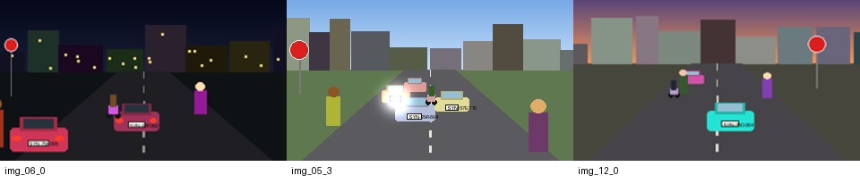

# Ba failure mode bắt buộc — quan sát fixture, không dùng GT

| Case | Ảnh | Camera/light | Sharpness | Baseline action | PoC action | Phân tích |
|---|---|---|---:|---|---|---|
| Ảnh đêm hữu ích | img_06_0 | cam_B/night | 275.665 | KEEP | RECAPTURE | Xe và người vẫn phân biệt được nhưng PoC loại vì dark score. Mean toàn ảnh bị nền trời tối chi phối; đây là false alarm quan sát được theo tiêu chí nhận diện tổng thể. |
| Glare biển số cục bộ | img_05_3 | cam_A/day | 1324.475 | KEEP | RECAPTURE | Quan sát vùng sáng che xe/biển số; sharpness toàn ảnh vẫn cao nên baseline KEEP. PoC phát hiện bằng tile saturation, review chọn RECAPTURE. |
| Camera mềm cam_B | img_12_0 | cam_B/dusk | 166.382 | RECAPTURE | RECAPTURE | Reviewer chọn KEEP nhưng sharpness thấp khiến baseline và PoC raw RECAPTURE. cam_B/dusk không đủ mẫu dev để fit group nên fallback global; chưa giải quyết được lỗi này. |

Đây là kết luận review định tính trên ảnh và metadata, không phải nhãn GT chính thức. Không chỉnh threshold sau các quan sát này.
